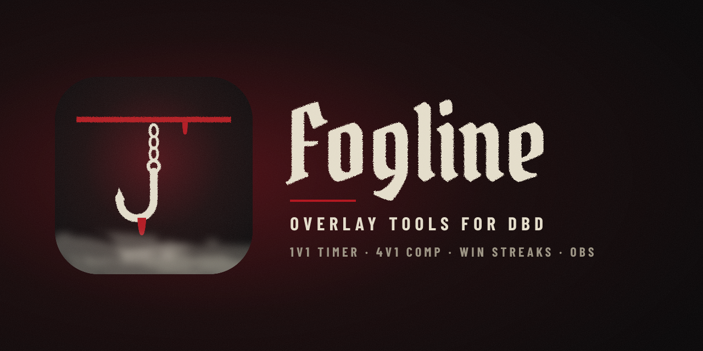

<h1 align="center">Fogline · Early Access</h1>

<b>Dead by Daylight comp timers and overlays: 1V1 chases, 4V1 matches, your win streak, and your stream.</b>

  

You are one of the first to try Fogline. Thank you! This page only holds the installer and its updates.

## Install

1. **Download** [`fogline-setup.exe`](https://github.com/leplayz7/early-access/releases/latest/download/fogline-setup.exe) (or open [Releases](https://github.com/leplayz7/early-access/releases/latest) and pick it there).
2. Your browser may say the file *"isn't commonly downloaded"*: choose **Keep** (in Edge: **…** → **Keep** → **Keep anyway**).
3. Open it. Windows may show **"Windows protected your PC"**: click **More info**, then **Run anyway**.
4. Follow the wizard (language, folder, start with Windows), then start Fogline.

> **Why the warning?** Fogline is new and its installer is not code-signed yet, so Windows SmartScreen does not know it.
> It is not a virus: Microsoft Defender finds nothing in it. The warning goes away as more people install it, and once
> the installer is signed.

## Activate

The first time Fogline starts it asks for your **activation code**. Type the code you were given (like `XXXX-XXXX-XXXX-XXXX`)
and press **Activate**. Each code works on **one PC**; to move it to another PC, ask for it to be reset.

## Updates

Fogline checks for updates by itself. When a new version is out, it offers it in the app and in the tray menu: press
**Update** and it restarts on the new version, your settings and code kept.

## Problems or ideas

Open an [issue](https://github.com/leplayz7/early-access/issues) and say what happened. **Settings → Help** in the
app opens this page too.

Windows 10 or 11, 64-bit.

---

## بالعربي

**التحميل:** نزّل [`fogline-setup.exe`](https://github.com/leplayz7/early-access/releases/latest/download/fogline-setup.exe).
إن قال المتصفح إن الملف «غير شائع التحميل» فاختر **الاحتفاظ به**. وإن ظهرت رسالة **«Windows protected your PC»** فاضغط
**More info** ثم **Run anyway**: البرنامج جديد وغير موقّع بعد، وليس فيه فيروس.

**التفعيل:** أول تشغيل يطلب **كود التفعيل**؛ اكتب الكود الذي أُعطيته واضغط **تفعيل**. كل كود لجهاز واحد.

**التحديثات:** يبحث البرنامج عن التحديثات بنفسه، وحين يصدر إصدار جديد اضغط **تحديث**.

